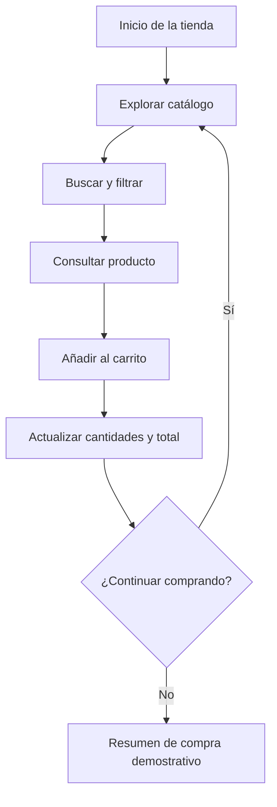

# Especificación técnica frontend para una tienda virtual de cosméticos

**Proyecto:** Tienda online de productos cosméticos y belleza  
**Enfoque:** Diseño de interfaz (UI), experiencia de usuario (UX) y comercio electrónico  
**Tecnologías permitidas:** HTML5, CSS3 y JavaScript puro (Vanilla JavaScript)  
**Alcance:** Exclusivamente frontend, sin backend, bases de datos ni frameworks.

## 1. Objetivo del proyecto

Desarrollar una interfaz web moderna, atractiva, intuitiva y adaptable a dispositivos móviles para un negocio dedicado a la venta de cosméticos. La plataforma permitirá explorar productos, consultar precios y características, filtrar categorías, gestionar un carrito de compras visual y simular el proceso de compra desde el navegador.

La experiencia debe transmitir belleza, confianza, calidad y facilidad de uso, sin sacrificar el rendimiento ni la accesibilidad.

## 2. Análisis de referentes comerciales

Se toman como referencia tres tiendas reales para identificar buenas prácticas de comercio electrónico de belleza. La propuesta utiliza esos aprendizajes como inspiración funcional, sin copiar su identidad visual ni su contenido.

### 2.1 Sephora
Sitio oficial: https://www.sephora.com/

- Navegación por categorías de belleza.
- Promociones y productos destacados.
- Acceso visible a la cuenta y al carrito.

**Aplicación en el proyecto:** menú organizado, ofertas destacadas y acceso permanente al carrito.

### 2.2 Glossier
Catálogo: https://www.glossier.com/en-co/collections/all

- Diseño limpio con protagonismo de las fotografías.
- Precios visibles y botones para añadir al carrito.
- Productos presentados de forma clara.

**Aplicación en el proyecto:** catálogo minimalista, fichas de producto claras y filtros útiles.

### 2.3 NYX Professional Makeup
Sitio oficial: https://www.nyxcosmetics.es/

- Organización por rostro, ojos, labios y accesorios.
- Productos clasificados por tonos y acabados.
- Promoción de novedades y colecciones.

**Aplicación en el proyecto:** categorías específicas, filtros de búsqueda y secciones de novedades.

### Conclusión del análisis

La propuesta combina navegación sencilla, fotografías de calidad, categorías claras, filtros funcionales y un carrito accesible. Estos elementos se pueden desarrollar con HTML, CSS y JavaScript sin depender de frameworks.

## 3. Propuesta de diseño UI/UX

La tienda tendrá una identidad visual propia, con un estilo moderno, elegante e inclusivo para diferentes públicos interesados en cosméticos.

**Nombre conceptual:** LÚMINA BEAUTY  
**Mensaje principal:** “Descubre tu mejor versión”.  
**Propuesta de valor:** encontrar maquillaje y productos de cuidado personal en un solo lugar.

### Sistema visual

| Elemento | Especificación |
|---|---|
| Paleta principal | Rosa suave `#F6E9E8` |
| Color secundario | Nude `#D7B6A8` |
| Color de contraste | Ciruela oscuro `#38282D` |
| Fondo | Marfil `#FFFDFB` |
| Tipografía para títulos | Georgia o serif del sistema |
| Tipografía para textos | Arial o sans-serif |
| Botones | Bordes suaves, texto legible y estados interactivos |
| Tarjetas | Fotografía, nombre, precio, valoración opcional y botón de compra |

Las imágenes deben tener proporciones consistentes y buena resolución. Los botones deben distinguirse claramente de los enlaces y los elementos decorativos.

## 4. Estructura funcional del sitio

La página se organizará en siete módulos principales.

### 4.1 Encabezado y navegación
- Logotipo y nombre comercial.
- Menú de categorías.
- Buscador de productos.
- Acceso a favoritos y carrito.
- Menú desplegable en dispositivos móviles.

### 4.2 Banner principal
- Imagen editorial de cosméticos.
- Mensaje comercial breve.
- Botón de llamada a la acción.
- Enlace a novedades o promociones.

### 4.3 Categorías de productos
- Maquillaje para rostro.
- Labios y ojos.
- Cuidado facial.
- Cuidado corporal.
- Accesorios y kits de belleza.

### 4.4 Catálogo de productos
- Tarjetas con imagen, nombre y precio en pesos colombianos.
- Filtro por categoría y rango de precios.
- Búsqueda por nombre.
- Ordenamiento por precio y nombre.
- Botones para ver detalles y añadir al carrito.

### 4.5 Carrito de compras
- Añadir y eliminar productos.
- Cambiar cantidades.
- Calcular subtotal y total estimado.
- Mostrar un mensaje cuando esté vacío.
- Conservar el carrito al recargar la página.

### 4.6 Favoritos
- Marcar y desmarcar productos.
- Consultar una lista de favoritos.
- Conservar la selección localmente.

### 4.7 Pie de página
- Información de la tienda.
- Preguntas frecuentes.
- Políticas de ejemplo.
- Contacto y redes sociales.
- Aviso de que las compras son demostrativas.

## 5. Especificación técnica

### 5.1 HTML5 — estructura
Define la semántica de la página, el encabezado, los menús, las secciones, las tarjetas, los formularios y los diálogos. Se utilizarán etiquetas como `header`, `nav`, `main`, `section`, `article` y `footer`.

### 5.2 CSS3 — presentación
Gestiona colores, tipografía, espaciado, diseño con Flexbox y Grid, animaciones discretas, estados de los controles y adaptación a móviles mediante media queries.

### 5.3 JavaScript — comportamiento
Administra búsqueda, filtros, ordenamiento, cantidades, favoritos, carrito, totales e interacciones de la interfaz.

**Restricciones técnicas:** no utilizar React, Angular, Vue, Bootstrap, Tailwind, jQuery, Node.js, Express, PHP ni servicios de backend. Se trabajará exclusivamente con archivos estáticos y JavaScript nativo.

### 5.4 Arquitectura de archivos

```text
tienda-cosmeticos/
│
├── index.html
│
├── css/
│   ├── styles.css
│   ├── responsive.css
│   └── components.css
│
├── js/
│   ├── app.js
│   ├── products.js
│   ├── catalog.js
│   ├── cart.js
│   └── favorites.js
│
└── assets/
    ├── images/
    └── icons/
```

| Archivo | Responsabilidad |
|---|---|
| `index.html` | Estructura principal y secciones de la tienda. |
| `styles.css` | Variables visuales, colores, fuentes y estilos generales. |
| `responsive.css` | Adaptación a móviles, tabletas y computadores. |
| `components.css` | Tarjetas, botones, formularios y ventanas emergentes. |
| `app.js` | Inicialización y coordinación de los módulos. |
| `products.js` | Catálogo de productos de demostración. |
| `catalog.js` | Búsqueda, filtros y ordenamiento. |
| `cart.js` | Gestión de cantidades y cálculos del carrito. |
| `favorites.js` | Gestión de los productos favoritos. |

Los módulos JavaScript pueden conectarse mediante `type="module"` en el HTML.

## 6. Requisitos de comportamiento

| Funcionalidad | Implementación frontend |
|---|---|
| Buscar productos | Filtrar por nombre o descripción. |
| Filtrar categorías | Mostrar únicamente la categoría seleccionada. |
| Filtrar por precio | Aplicar límites mínimo y máximo. |
| Ordenar catálogo | Precio ascendente, descendente o nombre. |
| Ver detalles | Abrir un modal con información del producto. |
| Añadir al carrito | Incorporar el producto y actualizar cantidades. |
| Calcular total | Multiplicar precios por cantidades y sumar los importes. |
| Guardar preferencias | Utilizar `localStorage` para carrito y favoritos. |
| Validar formularios | Comprobar campos obligatorios y formato de correo. |
| Mostrar notificaciones | Confirmar acciones y explicar errores. |

El catálogo inicial utilizará objetos JavaScript, por ejemplo:

```javascript
const productos = [
  {
    id: 1,
    nombre: "Labial Rosa Nude",
    categoria: "Labios",
    precio: 35000,
    imagen: "assets/images/labial.jpg",
    descripcion: "Labial de acabado suave para uso diario.",
    disponible: true
  },
  {
    id: 2,
    nombre: "Sérum Facial",
    categoria: "Cuidado facial",
    precio: 58000,
    imagen: "assets/images/serum.jpg",
    descripcion: "Producto cosmético para complementar la rutina facial.",
    disponible: true
  }
];
```

Los productos y precios son ejemplos que deberán ajustarse al inventario real.

### Flujo de interacción



## 7. Criterios de diseño UX

La interfaz debe facilitar las tareas habituales sin exigir que el usuario aprenda cómo funciona la tienda.

- **Navegación intuitiva:** categorías identificables y búsqueda fácil de encontrar.
- **Jerarquía visual:** destacar el producto, el precio y la acción principal.
- **Retroalimentación:** mostrar confirmaciones cuando se añadan artículos o se apliquen filtros.
- **Diseño adaptable:** evitar desplazamientos horizontales y mantener controles cómodos para tocar en pantallas pequeñas.
- **Accesibilidad:** textos alternativos en imágenes, etiquetas para campos, navegación por teclado, foco visible y contraste suficiente.
- **Rendimiento:** imágenes optimizadas, JavaScript modular y carga diferida de imágenes secundarias.
- **Confianza:** precios claros, descripciones precisas y políticas informativas sin promesas comerciales inventadas.

## 8. Adaptación a dispositivos

Puntos de referencia para los breakpoints CSS:

- **Móvil:** hasta 600 px.
- **Tableta:** 601–900 px.
- **Escritorio:** más de 900 px.

Estos valores son orientativos y deberán verificarse con pruebas de contenido y resolución.

## 9. Alcance y limitaciones

Es importante distinguir una tienda visual funcional de un ecommerce conectado a servicios reales.

| Incluido | Fuera del alcance |
|---|---|
| Catálogo de prueba | Base de datos real |
| Carrito local | Pedidos persistentes en servidor |
| Filtros y búsqueda | Inventario sincronizado |
| Favoritos guardados en el navegador | Cuentas de usuario reales |
| Resumen de compra simulado | Pasarela de pagos |
| Formularios con validación local | Envío real de correos |
| Diseño responsive | Panel administrativo conectado |

`localStorage` guarda información en el navegador, pero no sincroniza los datos entre dispositivos ni proporciona seguridad para información sensible. No se deben recopilar datos bancarios ni simular que un pago ha sido procesado.

## 10. Pruebas de aceptación

- [ ] La página carga sin errores en la consola.
- [ ] Los enlaces y botones tienen una función real.
- [ ] La búsqueda y los filtros funcionan simultáneamente.
- [ ] El carrito calcula correctamente los subtotales y el total.
- [ ] Las cantidades no pueden ser negativas ni inválidas.
- [ ] El carrito y los favoritos se conservan al recargar el navegador.
- [ ] Los formularios validan sus campos.
- [ ] La interfaz se adapta a móvil, tableta y escritorio.
- [ ] Los controles son utilizables mediante teclado.
- [ ] No existen enlaces rotos ni imágenes sin alternativa textual.
- [ ] El proceso de compra se identifica claramente como demostrativo.

## 11. Resultado esperado

El resultado será una tienda de cosméticos con una interfaz profesional, un catálogo dinámico y una experiencia de compra simulada. El proyecto quedará organizado para que posteriormente se pueda conectar a una API o backend, sin que esas tecnologías formen parte de esta primera entrega.

**Recomendación final:** comenzar por el diseño responsive de `index.html`, construir el sistema visual en CSS y después implementar los módulos JavaScript en este orden: catálogo, filtros, carrito y favoritos. Así se podrá verificar cada funcionalidad antes de integrar la siguiente.
